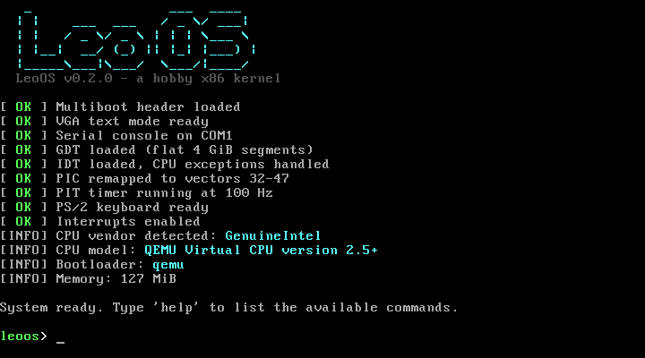

# LeoOS - a mini x86 kernel

A small 32-bit Multiboot kernel written from scratch in C and x86 assembly. It boots, sets up the CPU's descriptor tables, handles interrupts, and drops into an interactive shell.



## Features
* **Multiboot compliant:** Loaded by any Multiboot bootloader (GRUB, or QEMU's `-kernel` option). It reads the memory map and the bootloader's name from the Multiboot information structure.
* **GDT and IDT:** A flat memory model with kernel and user segments, and 48 interrupt gates generated by NASM macros.
* **CPU exceptions:** Any fault (division by zero, general protection fault, page fault...) ends on a panic screen with a full register dump.
* **Hardware interrupts:** The 8259 PIC is remapped to vectors 32-47, and spurious IRQs are detected.
* **PIT timer:** A 100 Hz system tick, used for `uptime` and `sleep`.
* **PS/2 keyboard driver:** French AZERTY and US QWERTY layouts, Shift, Caps Lock, AltGr and Ctrl, plus arrow keys. Accented characters are displayed through the VGA code page 437.
* **VGA text mode console:** 16 colors, scrolling and a hardware cursor.
* **Serial console (COM1):** All output is mirrored to the serial port, and the shell also accepts input from it, so the kernel works in a plain terminal.
* **`kprintf`:** A freestanding `printf` with `%s %c %d %u %x %p`, field widths, and `-`/`0` flags.
* **Interactive shell:** Command history (Up/Down), Tab completion and line editing.
* **CPU detection:** The vendor, brand string, family/model and feature flags, read through `cpuid`.

## Shell commands
| Command | Description |
|---|---|
| `help` | List the commands |
| `clear` | Clear the screen (also `Ctrl+L`) |
| `echo <text>` | Print a line of text |
| `about` | Kernel version and build information |
| `cpu` | Processor information (CPUID) |
| `mem` | Kernel location and the bootloader memory map |
| `uptime` | Time elapsed since boot |
| `sleep <ms>` | Wait using the PIT timer |
| `color <fg> [bg]` | Change the text colors |
| `layout [fr\|us]` | Show or change the keyboard layout |
| `history` | Previous commands |
| `crash` | Trigger a division by zero to show the panic screen |
| `reboot` | Restart through the 8042 keyboard controller |
| `shutdown` | Power off (QEMU, Bochs, VirtualBox) |

## Prerequisites
* `gcc` (with 32-bit support, `-m32`)
* `nasm`
* `ld` (binutils)
* `qemu-system-i386` (for emulation)
* Optional: `grub-mkrescue` and `xorriso` to build a bootable ISO

## Building and running
```sh
make                # build build/leoos.bin
make run            # boot in a QEMU window, serial output in the terminal
make run-nographic  # use the shell from the terminal only (quit: Ctrl+A then X)
make debug          # wait for GDB: gdb build/leoos.bin -ex 'target remote :1234'
make iso            # build a bootable GRUB image: build/leoos.iso
make clean
```

The default keyboard layout is AZERTY. QEMU forwards physical key positions, so on a QWERTY keyboard run `layout us`.

## Project structure
```
.
├── include/          headers
├── src/
│   ├── boot.s        Multiboot header, stack setup, jump to kernel_main
│   ├── gdt_flush.s   loads the GDT and reloads the segment registers
│   ├── interrupts.s  interrupt stubs and the common handler
│   ├── kernel.c      kernel_main: boot sequence
│   ├── gdt.c         Global Descriptor Table
│   ├── idt.c         Interrupt Descriptor Table and dispatch
│   ├── pic.c         8259 PIC driver
│   ├── timer.c       PIT driver
│   ├── keyboard.c    PS/2 keyboard driver and layouts
│   ├── vga.c         VGA text mode driver
│   ├── serial.c      COM1 serial driver
│   ├── kprintf.c     console output and formatted printing
│   ├── kstring.c     memset, memcpy, strlen...
│   ├── cpu.c         CPUID detection
│   ├── panic.c       panic screen and exception reports
│   ├── power.c       reboot and shutdown
│   └── shell.c       interactive shell
├── linker.ld         places the kernel at 1 MiB
└── Makefile
```

## Roadmap
* Physical memory manager (a page frame allocator built from the memory map)
* Paging and a kernel heap (`kmalloc`)
* Multitasking
* User mode (ring 3) and system calls

## Acknowledgments
* [OSDev.org](https://wiki.osdev.org/)
